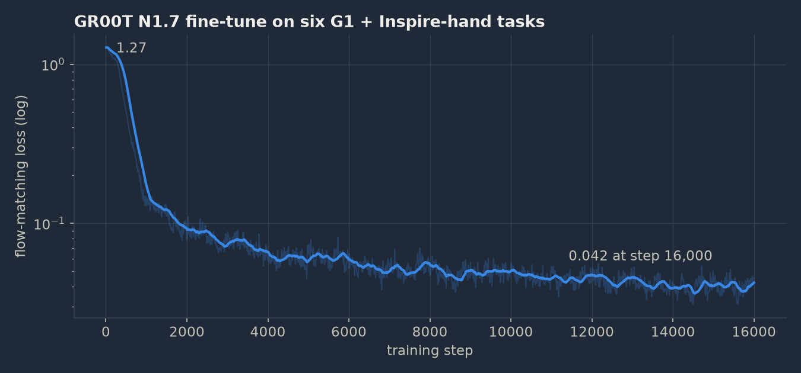
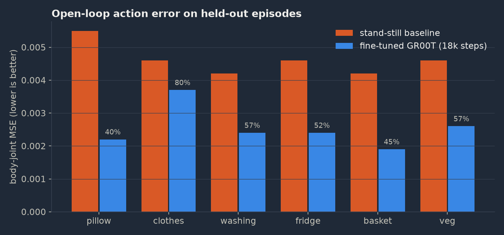
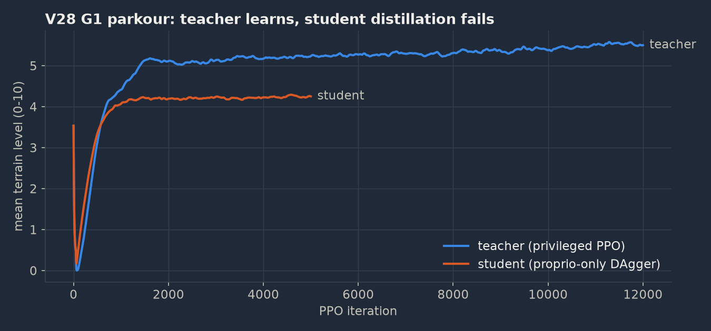
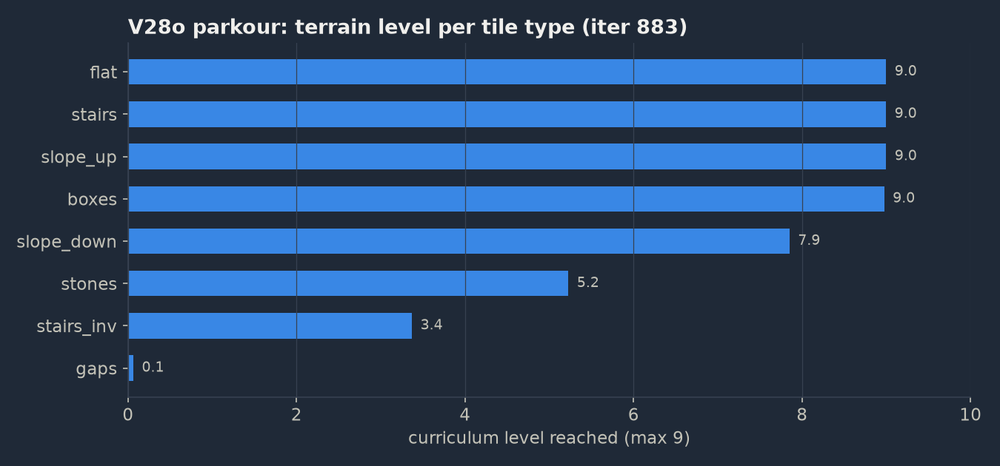
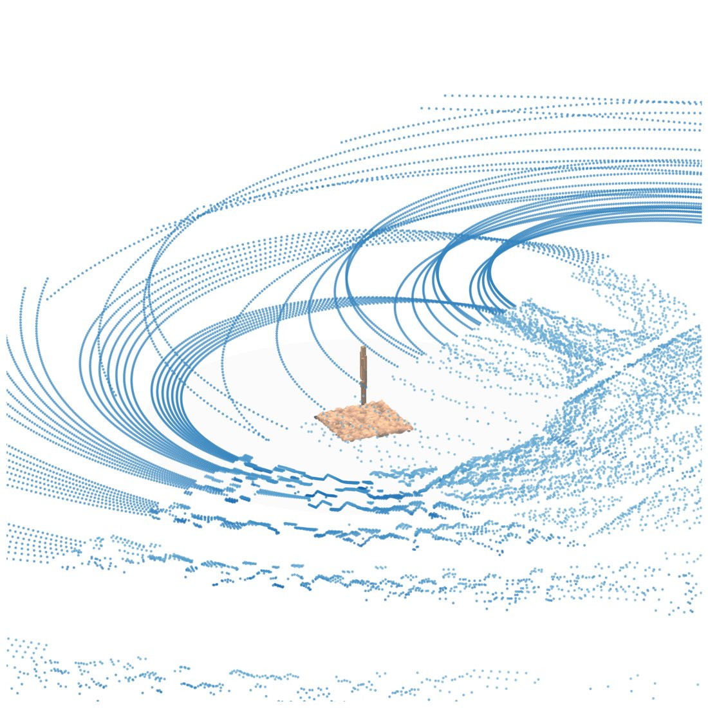
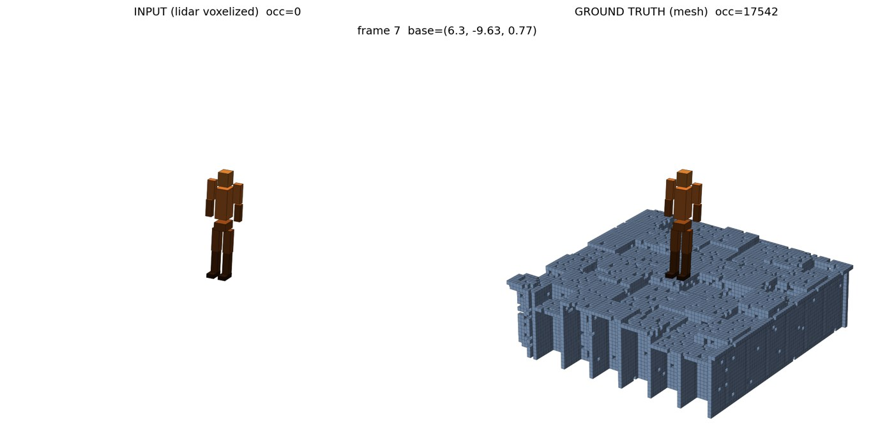
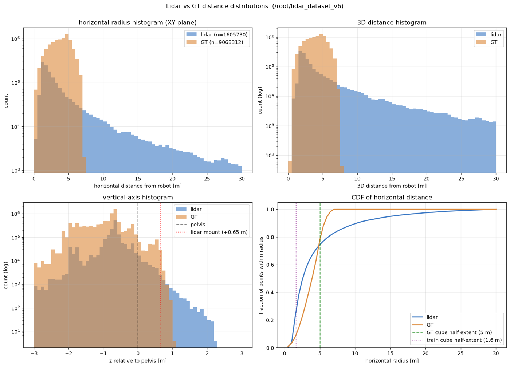
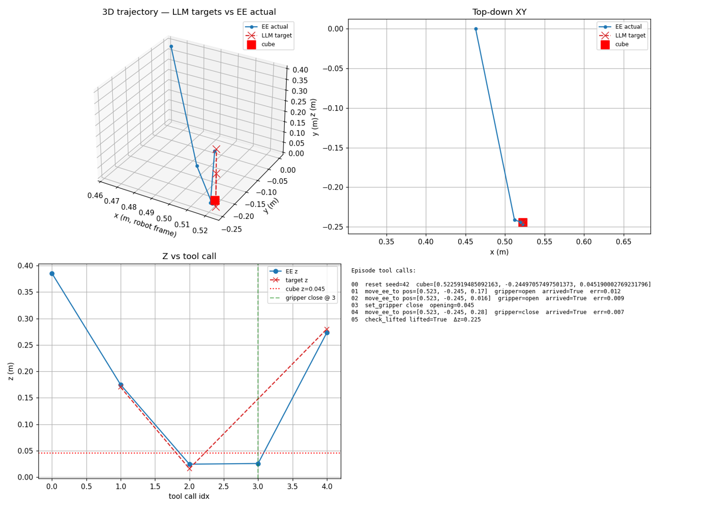

# Unitree G1 Humanoid: GR00T, Cosmos Dreams, LiDAR and Parkour

Code for training a Unitree G1 humanoid with the current open robotics stack, end to end. The project
has five parts:

1. **Fine-tuning GR00T N1.7**, NVIDIA's 3B vision-language-action model, on real whole-body
   teleoperation data with dexterous 6-DoF Inspire hands.
2. **Fine-tuning Cosmos-Predict2.5**, a 2B video world model, so it "dreams" new robot videos from one
   image and a sentence, plus an **inverse dynamics model** that recovers the robot actions from those
   videos (the GR00T-Dreams / DreamGen idea: generate training data instead of collecting it).
3. **Locomotion and parkour** for the G1 with PPO in IsaacLab on 16k-20k parallel robots.
4. **LiDAR perception**: reconstructing the terrain around the robot from a simulated head-mounted
   LiDAR, comparing a sparse 3D U-Net with point-cloud networks.
5. **A latent-action world model** (JEPA-style): learning, from video alone, a compact code for "what
   happened between two frames", and testing whether it captures real robot actions.

| Part | Main result |
|---|---|
| GR00T fine-tune | Beats a stand-still baseline on all six tasks (open loop); closed loop is much harder |
| Cosmos + inverse dynamics | Plausible videos even for a held-out task; recovered actions at 6.7° mean joint error |
| Parkour | Top difficulty on 7 of 8 terrain types; gaps only partly solved; the student policy never worked |
| LiDAR reconstruction | All three encoders tie at IoU 0.20; the real limit was a blind zone in the sensor mount |
| Latent-action world model | Its code predicts real robot motion (R² up to 0.40), but a learned prior lost to simple sampling baselines |

Everything was trained on rented A100 and H100 GPUs. Two smaller experiments live in [`tools/`](tools/):
an LLM that drives a robot arm through tool calls, and an LLM agent that makes static 3D assets
interactive in Isaac Lab.

```
first frame + caption  ──►  Cosmos-Predict2.5 (LoRA)  ──►  dream video
                                                               │
                                                               ▼
                                                 inverse dynamics model
                                                               │
                                                               ▼
                                              (state, action) training pairs
                                                               │
                                                               ▼
                                                  GR00T N1.7 fine-tune
```

## Repository map

| Folder | Part | Contents |
|---|---|---|
| [`gr00t_finetune/`](gr00t_finetune/) | 1 | New-embodiment modality config, dataset split/pull scripts, multi-dataset training wrapper and launchers, open/closed-loop eval, MuJoCo visualisation, eval results |
| [`cosmos_dreams/`](cosmos_dreams/) | 2 | Video dataset preparation, Cosmos-Predict2.5 LoRA experiment config + checkpoint key-remap patch, earlier Cosmos-Predict2 LoRA configs and dream-generation scripts |
| [`inverse_dynamics/`](inverse_dynamics/) | 2 | Patch for GR00T-Dreams (G1 embodiment, 41-D actions), training launchers, eval, dream video → actions → MuJoCo pipeline |
| [`locomotion/`](locomotion/) | 3 | `diff_loco` IsaacLab package: G1 parkour envs, rewards, curricula, teacher-student and PPO configs V28-V55, diffusion / flow-matching / transformer actors |
| [`lidar_perception/`](lidar_perception/) | 4 | Simulated MID-360 setup, dataset collection, three encoders, training, eval, temporal models, visualisation |
| [`latent_action_jepa/`](latent_action_jepa/) | 5 | Latent-action JEPA models, stage-1/stage-2 training, priors, probes and diagnostics; from-scratch V-JEPA variant on BridgeData V2 |
| [`tools/llm_robot_control/`](tools/llm_robot_control/) | extra | Isaac Lab TCP sim server + tool client so a language model can move a Franka / G1 arm |
| [`tools/scene_pipeline/`](tools/scene_pipeline/) | extra | LLM agent that splits a static 3D asset into parts and adds joints and lights for Isaac Lab |
| [`docs/media/`](docs/media/) | all | Figures and short videos used below |

Each folder has its own README with the exact commands.

---

## 1. GR00T N1.7 on a new embodiment

The stock GR00T N1.7 G1 configuration assumes binary grippers and extra navigation commands; the
Unitree teleop datasets have a 6-DoF Inspire hand on each side and no navigation commands, so the
pretrained action projector cannot be loaded. A new embodiment was registered and a fresh projector
was trained together with the 1.1B diffusion-transformer action head, with the vision-language backbone
frozen (1.62B of 3.14B parameters trainable). Data: six Unitree whole-body teleop datasets, 51 GB,
1,843 train / 459 val episodes (~847k train frames).

Training ran on one A100 80 GB for about 9.5 h (AdamW, lr 1e-4, batch 32), planned for 60k steps and
stopped at 18k when the disk filled during a checkpoint save (24 GB per checkpoint with optimizer
state); the weights were recovered. The loss drops 30x in the first 4k steps.

| Evaluation (held-out episodes, 16-step action chunks) | Result |
|---|---|
| vs. random-projector baseline (only possible "zero-shot" model for this hand) | 50-66x lower error |
| vs. stand-still baseline (predict current pose) | better on all six tasks, 40-80 % of its error |
| best / hardest task | pillow and basket / collecting clothes |
| hand vs. body error | hand error about 5-10x body error |
| closed loop in MuJoCo (earlier Dex5-hand run) | errors 200-300x larger than open loop; barely beats standing still |

<p> </p>

## 2. Cosmos-Predict2.5 dreams and inverse dynamics

LoRA fine-tune of Cosmos-Predict2.5 2B Video2World (rank 32 on attention and MLP layers of the DiT) on
27 clips from three tasks (pillow, clothes, washing machine); the fridge task was held out. Loading the
LoRA needed a patch: the loader did not strip the activation-checkpointing wrapper prefix from weight
names, so every LoRA target was silently unmatched and the DiT started from random weights. 8,000
iterations on one H100 (~3.6 s/iteration, ~296 epochs); loss flat around 0.05-0.13, validation loss at
iteration 7000 (0.078) matched training loss.

Base model vs fine-tuned, same first frame and prompt:
[train task: washing machine](docs/media/cosmos_train_washing.mp4) ·
[held-out task: fridge](docs/media/cosmos_val_fridge.mp4) ·
[OOD: basket](docs/media/cosmos_ood_basket.mp4) ·
[OOD: washing machine seed](docs/media/cosmos_ood_washing.mp4).
Earlier Cosmos-Predict2 fine-tune (Dex5-hand data), single held-out photo + sentence:
[pillow under table](docs/media/dream_pillow_under_table_plain.mp4) ·
[pillow from under table onto table](docs/media/dream_pillow_under_table_place.mp4) ·
[cup prompt, pillow scene](docs/media/dream_ood_cup_pillow.mp4) ·
[cup prompt, washer scene](docs/media/dream_ood_cup_washer.mp4).

The **inverse dynamics model** (614M parameters, SigLIP2-large vision encoder + DiT flow-matching
action head) takes a video chunk, the start state and the instruction and predicts the 41 joint actions
(legs, waist, arms, both hands). After 6,000 steps the loss sat at 0.95 (noise level); continuing to
30,000 steps (~3.5 h on an A100) it broke through around step 15k and ended at 0.13, 7.3x lower.

| Joint group | Error at 6k steps | Error at 30k steps |
|---|---|---|
| Left leg | 14.5° | **5.6°** |
| Right leg | 15.6° | **6.4°** |
| Waist | 9.6° | **5.0°** |
| Left arm | 16.7° | **8.5°** |
| Right arm | 19.8° | **9.7°** |
| Left hand | 6.2° | **1.5°** |
| Right hand | 14.7° | **10.0°** |
| **Overall** | **13.9°** | **6.7°** |

[Whole pipeline in one clip](docs/media/idm_3panel.mp4): Cosmos dream | IDM-recovered actions replayed
on a G1 in MuJoCo | per-joint action values.

## 3. Locomotion and parkour in IsaacLab

PPO in IsaacLab with 16,384-20,480 robots in parallel on one GPU at ~135k simulation frames per second.
Terrain curriculum of ten difficulty levels for eight tile types (flat, stairs up/down, slopes up/down,
boxes, stepping stones, gaps); robots are promoted when they walk far enough and demoted when they fail.
Teacher-student setup: the teacher sees privileged simulator state, the student only what the real robot
can sense.

| Run | Change | Outcome |
|---|---|---|
| V28 teacher | privileged PPO, 12k iterations | 5.3 % fall rate, 0.28 m/s velocity error |
| V28 student | distillation to proprioceptive policy | failed: 9x the falls, never committed to actions (no angular velocity, too short a history) |
| V28b | bigger networks, critic sees foot forces | same reward 5x faster, no higher ceiling |
| V28c | lower `feet_air_time` weight | fixed asymmetric gait; best tracking of the series (0.23 m/s, 0.67 rad/s) |
| V28d | latency 0-40 ms, ±20 % motor gains, armature, torque-rate penalty | reward collapsed by 79 % ("don't move" became optimal) |
| V28e-g → V28n | mixture-of-experts actor → plain MLP | MoE caused a crouching duck walk; plain network fixed it |
| V28o | curriculum fixes | three bugs in the terrain curriculum found and fixed |
| V30 | reward rebalance | 5 of 8 terrain types saturated, gaps stuck at 0.43 of 9 |
| VBaseV2 | stock G1 setup, stronger long-step reward | mean level 5.61, gaps 5.91 of 9, fall rate halved to 3.5 % |
| V51 | 5-frame proprioception history | top level (9) on 7 of 8 terrain types within ~600 iterations (no final evaluation logged) |
| V52 / V53 | transformer + ViT height map / zigzag plates | dead ends: 100 % falls / plates ignored |
| diffusion actors (pre-V28) | diffusion, flow-matching and transformer actors trained with PPO | best: terrain level 3.50 of 10 with 68 % falls, well below a plain MLP |

**Retracted result:** one variant (V30-plain) reached a mean terrain level of 8.45; that came from a
relaxed promotion rule in the custom curriculum, not from skill. Under IsaacLab's stock curriculum the
same family of policies sits at about 5.6-5.8, which is the number reported.

<p> </p>

Videos: [V28c teacher on the terrain course](docs/media/parkour_v28c.mp4) ·
[V28d teacher at the hardest level](docs/media/parkour_v28d_l9.mp4).

## 4. LiDAR terrain reconstruction

Simulated Livox MID-360 (40 channels × 500 azimuths, 30 m range, mounted upside down on the head as on
the real robot). Networks reconstruct the true terrain, voxelised into a 3.2 m cube of 5 cm voxels around
the robot, reproducing the setup of Hoeller et al. (2022). 8,000 frames from 16 environments and 10
terrain types, split by terrain tile.

| Encoder (~7.2M parameters) | IoU @ 0.5 | IoU @ 0.7 | Chamfer (m) | FPS |
|---|---|---|---|---|
| Sparse 4D U-Net (Hoeller 2022 reproduction) | 0.202 | 0.158 | 0.233 | 52 |
| PointNet-style encoder + sparse convolutions | 0.203 | **0.167** | 0.233 | 60 |
| Point-transformer encoder (simplified, attention-based) | 0.189 | 0.112 | 0.243 | 72 |

All three tie, and training twice as long did not help. A head-mounted LiDAR barely sees the ground in
front of the feet: in the first setup no LiDAR point landed inside the reconstruction cube (median
return 15 m away), and even in the final dataset only about a quarter of the returns fall within the
cube's 1.6 m half-width. Single-frame reconstruction is capped by sensor geometry, not architecture.

<p>  </p>

## 5. Latent-action world model (JEPA-style)

An inverse model compresses "what happened" between two frames into a small code Z; a forward model must
predict the later frame's features from the earlier frame plus Z, all in feature space (first a frozen
ImageNet ViT-S, later a ViT trained from scratch with the V-JEPA recipe). Test: given the current frame
and a Z, does the predicted future match the true future among all validation clips?

| Where Z comes from (100 validation clips) | Top-1 retrieval |
|---|---|
| Inverse model, sees the future (upper bound) | 0.97 |
| "Nothing changes" baseline | 0.15 |
| Learned deterministic prior | 0.15 |
| Learned flow-matching prior, best of 64 samples | 0.54 |
| Random training-set Z, best of 128 samples | **0.88** |
| Nearest-neighbour training-set Z, best of 512 samples | **0.91** |

- On 13 real hand-object films, a tight Z (4×128) ranks the right clip first 48 % of the time among
  2,600 (about 1,200x chance); an adversarial loss reduced Z's leak of film identity.
- On BridgeData V2, a linear probe on Z predicts the real robot actions with R² 0.26 (gripper position),
  0.29 (open/close) and 0.40 (vertical motion); shuffled control about 0.
- A goal-conditioned prior matched the upper bound (0.95) but is given the true future as its goal.
- Training collapsed in every configuration after about 12k steps, so early stopping was part of the recipe.

## Smaller experiments ([`tools/`](tools/))

- **LLM driving a robot through tool calls**: an Isaac Lab server exposes a few tools (read state, move
  the hand to a point, open/close the gripper, check whether the object is lifted) and a language model
  must solve the task within 20 calls. On a Franka arm it picks up the cube in 5 calls; on the G1 upper
  body the same task did not succeed. Single episodes, not a measured success rate.
- **Agent that makes 3D assets interactive**: given a static model (lamp, drawer, cash register), an LLM
  agent lists the real object's parts, splits the mesh accordingly and adds joints and lights so the
  object works in Isaac Lab. The cash register came out with 42 working keys.



---

## How to run (short version)

All heavy jobs assume a Linux machine with one 80 GB GPU; the IsaacLab parts also run on a desktop GPU
with fewer environments. See each folder's README for the full commands and arguments.

```bash
# 1. GR00T: split datasets (symlinks, no copy), then multi-dataset fine-tune inside an Isaac-GR00T checkout
python gr00t_finetune/data_prep/split_datasets.py --sources /data/<dataset_v2.1> ... --out-root /data/split_80_20
GR00T_REPO=~/Isaac-GR00T SPLIT_ROOT=/data/split_80_20 bash gr00t_finetune/train/launch_multitask.sh

# 2a. Cosmos-Predict2.5 LoRA: build clips, patch the loader, train the registered experiment
python cosmos_dreams/data_prep/prep_cosmos_data.py --out /data/g1_wbt_4task --tasks pillow clothes washing fridge
python cosmos_dreams/data_prep/split_cosmos25_train_val.py --src /data/g1_wbt_4task --dst ~/cosmos-predict2.5/datasets/g1_wbt
python cosmos_dreams/predict2_5/apply_lora_key_remap_patch.py   # edit P to your checkout first

# 2b. Inverse dynamics (inside a GR00T-Dreams checkout with the G1 patch)
bash inverse_dynamics/train/run_idm.sh && bash inverse_dynamics/train/run_idm_resume.sh
python inverse_dynamics/pipeline/idm_gen_traj.py --video dream.mp4 --out traj.npz

# 3. Locomotion (from locomotion/, with IsaacLab installed)
python -m diff_loco.train --task Isaac-Velocity-Parkour-G1-V28c-Teacher-v0 --num_envs 16384 --headless

# 4. LiDAR: collect, then train the three encoders and evaluate
python lidar_perception/collect_g1_lidar_dataset.py --num_envs 16 --num_frames 8000 --terrain diverse \n    --checkpoint <g1_rough_policy.pt> --output_dir /root/lidar_dataset_v6 --headless
bash lidar_perception/run_all_v6.sh 1500

# 5. Latent actions on BridgeData V2 (from-scratch variant) and its action probe
python latent_action_jepa/v6_from_scratch/train_v6.py --data_root /data/bridge/scripted_raw --out_dir runs/v6
python latent_action_jepa/v6_from_scratch/probe_v6.py --ckpt runs/v6/<ckpt>.pt
```

## Upstream dependencies

Third-party code is not vendored. Where it was modified, this repo contains the patch or patch script.

| Upstream | Version used | Used for | Local changes |
|---|---|---|---|
| [NVIDIA/Isaac-GR00T](https://github.com/NVIDIA/Isaac-GR00T) | commit `23ace64` (GR00T N1.7 release), weights `nvidia/GR00T-N1.7-3B` | part 1 | none; modality config + multi-dataset wrapper here |
| [NVIDIA/GR00T-Dreams](https://github.com/NVIDIA/GR00T-Dreams) | commit `ec3881d` | IDM training | [`inverse_dynamics/patches/gr00t_dreams_g1_idm.patch`](inverse_dynamics/patches/gr00t_dreams_g1_idm.patch) |
| [nvidia-cosmos/cosmos-predict2.5](https://github.com/nvidia-cosmos/cosmos-predict2.5) | April 2026 code (commit not recorded), weights `nvidia/Cosmos-Predict2.5-2B` | part 2 | key-remap patch script + dataset patch in `cosmos_dreams/predict2_5/` |
| [nvidia-cosmos/cosmos-predict2](https://github.com/nvidia-cosmos/cosmos-predict2) | April 2026 code (commit not recorded), 2B Video2World | earlier Dex5 dreams | experiment configs in `cosmos_dreams/predict2/` |
| [isaac-sim/IsaacLab](https://github.com/isaac-sim/IsaacLab) + Isaac Sim | IsaacLab 2.3.2 (setup script pins commit `4df6560e1`), Isaac Sim 5.1, rsl-rl 5.2 | parts 3, 4, tools | none; tasks registered from `diff_loco` |
| [traveller59/spconv](https://github.com/traveller59/spconv) | `spconv-cu120` | part 4 | none |
| MuJoCo + official Unitree G1 29-DoF / Inspire hand model | - | GR00T + IDM visualisation | scene file only |

Datasets (not included): Unitree `G1_WBT_Inspire_*` and `G1_WB_Dex5_*` teleop datasets on Hugging Face,
BridgeData V2, Charades, public-domain films from archive.org, and Poly Haven 3D models.

## Limitations

- **Student distillation failed.** The proprioceptive student fell 9x as often as the teacher; the
  observation gap was diagnosed (no angular velocity, too short a history) but no deployable student
  policy was produced. Nothing here was run on a real robot.
- **Retracted curriculum result.** The 8.45 mean terrain level of V30-plain came from a relaxed promotion
  rule; the honest number under the stock curriculum is about 5.6-5.8.
- **Gaps were only partly solved**, and V51's 7-of-8 result has no final logged evaluation.
- **GR00T closed loop is weak.** Open-loop wins over the stand-still baseline do not carry over to
  closed-loop rollouts (Dex5 run, MuJoCo), where the model barely beats standing still.
- **GR00T run stopped at 18k of 60k planned steps** (disk full), loss still decreasing.
- **The dream → IDM → GR00T loop is built but not closed at scale**: no GR00T model was retrained on
  IDM-labelled dream data. The IDM was trained on one task, and arm/right-hand errors (8-10°) are too
  loose for fine manipulation.
- **LiDAR reconstruction was never integrated into the locomotion policy**; the policies used the
  simulator's ray-cast height map. The temporal reconstruction models have no finished results.
- **The learned latent-action priors lost** to sampling Z from the training set.
- **Some code only existed on rented GPU machines and was not recovered**: the six-task Inspire GR00T
  modality config, launcher and open-loop eval script (the Dex5-era versions of the same scripts are
  included, plus the six-task eval outputs), and the Cosmos-Predict2.5 base-vs-LoRA inference command.
  Scripts contain example paths (`/workspace`, `/root`, `/data`) that must be adapted.
- The LLM tool-use results are single episodes, not success rates.
