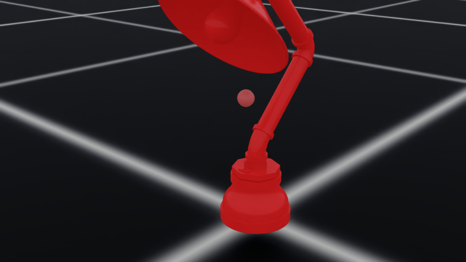
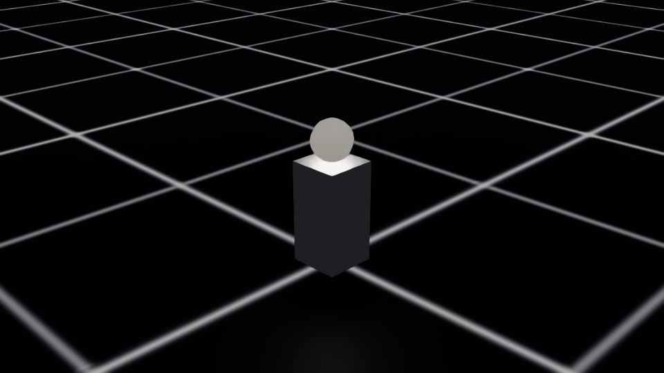

# Interactive 3D assets for Isaac Lab, built by an LLM agent

Given a static 3D model (a lamp, a drawer cabinet, a cash register), an LLM agent lists the real
object's moving / emitting parts, splits the mesh accordingly, and adds joints and lights so the object
works in Isaac Lab. The agent follows [`PIPELINE_MANUAL.md`](PIPELINE_MANUAL.md), the operating manual
written for it (inventory the real object first, diff it against the asset's prim tree, extract baked
geometry, write a spec, build a wrapper USD, test it in a demo). The cash register came out with 42
working keys.

```
asset (.usd/.glb/.fbx)  → convert_to_usd.py → inspect_usd.py (prim tree JSON)
   → extract_all_components.py / extract_part.py (split baked meshes) → cluster_components.py
   → classify_with_llm.py (LLM labels every part: real-world identity, joint type, effect)
   → spec_from_llm_plan.py → spec/<asset>.json → make_interactive.py (wrapper USD)
   → demo_interactive.py / demo_press_to_toggle.py (animate, toggle linked lights, render)
```

## Layout

| Path | What it does |
|---|---|
| `scripts/inspect_usd.py`, `validate_usd.py`, `dump_usd_text.py` | Dump / check a USD's prim tree, meshes, materials, textures |
| `scripts/propose_interactives.py`, `extract_part.py`, `extract_all_components.py`, `cluster_components.py`, `augment_components.py` | Split baked meshes into connected components, group multi-piece parts, add orientation cues |
| `scripts/classify_components.py`, `classify_with_llm.py`, `spec_from_llm_plan.py` | Heuristic and LLM part classification (OpenAI API, model from `OPENAI_MODEL`), conversion of the LLM plan into a spec |
| `scripts/make_interactive.py`, `make_interactive_lamp.py` | Build the wrapper USD: references the source asset, adds lights, stores interactive descriptors as custom data |
| `scripts/demo_*.py`, `view_scene_isaaclab.py`, `scene_cfg.py` | Isaac Lab demos (scripted toggles, a kinematic finger pressing a switch) and scene loading |
| `runtime/interactions.py`, `physics_attach.py` | Runtime control of lights / animated parts and physics attachment in a live stage |
| `spec/` | Specs for the cash register, drawer cabinet and pipe lamp |
| `assets/usd/` | Generated wrapper USDs (they reference the source models under `assets/source/`, not included) |
| `examples/` | An LLM physics plan for the cash register and two rendered frames |

## Run

Source models are Poly Haven 1k assets (CC0), not redistributed: download them into
`assets/source/<name>/` (the manual shows the Poly Haven API calls). Copy `.env.example` to `.env`
and set `OPENAI_API_KEY` for the LLM step. Scripts run with IsaacLab's Python
(`isaaclab.sh -p` on Linux, `isaaclab.bat -p` on Windows).

```bash
isaaclab.sh -p scripts/inspect_usd.py --usd assets/source/cash_register/CashRegister_01_1k.usdc --out_json outputs/cashreg_tree.json
python scripts/classify_with_llm.py --tree outputs/cashreg_tree.json \
    --object_kind "vintage hand-crank cash register" \
    --out_json outputs/cashreg_physics_plan.json --out_md outputs/cashreg_physics_plan.md
isaaclab.sh -p scripts/make_interactive.py --spec spec/cash_register_full.json
isaaclab.sh -p scripts/demo_interactive.py --usd assets/usd/cash_register_v3.usd --pos 0,0,0 \
    --cycles 6 --period_s 5 --out_dir outputs/cashreg_demo
```

 
